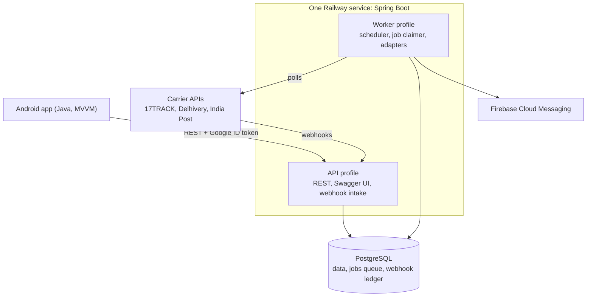

# TrackHub

A personal parcel tracker that aggregates shipments across carriers (17TRACK, Delhivery, India Post),
normalizes their statuses into one state machine, and notifies you when something changes.

It is a portfolio project, so it favours clean architecture, tests, and measured engineering
decisions over feature count. Every significant choice is recorded in [`docs/decisions`](docs/decisions).

> Status: Phase 1 in progress (core domain + first carrier adapter).

## Architecture



| Module | Holds | Depends on |
| --- | --- | --- |
| `trackhub-domain` | Business rules in plain Java: shipments, status state machine, ports | JDK only |
| `trackhub-carriers` | One adapter per carrier (JDK HTTP client + Jackson), tested against WireMock | `trackhub-domain` |
| `trackhub-app` | Spring Boot: web, persistence, jobs, scheduling | both of the above |

## Running locally

Requires Java 21 and Maven 3.9+.

```bash
cp .env.example .env      # fill in values; .env is git-ignored
mvn verify                # build, run all tests, enforce coverage
mvn -pl trackhub-app spring-boot:run
curl localhost:8080/actuator/health
```

The app refuses to start without `GOOGLE_CLIENT_ID` and `TRACK17_API_KEY`. Tests need neither
(they use fakes), but they do need Docker for Postgres.

## API

Interactive docs at `http://localhost:8080/swagger-ui.html`; the OpenAPI document is at
`/v3/api-docs`. Every `/api` call needs a Google ID token as the bearer token
([ADR 0014](docs/decisions/0014-google-id-tokens.md)).

| Method and path | What it does |
|---|---|
| `POST /api/shipments` | Start tracking a number; the carrier is detected if not given |
| `GET /api/shipments?page=0&size=20` | Your parcels, newest first |
| `GET /api/shipments/{id}` | One parcel with its timeline |
| `POST /api/shipments/{id}/refresh` | Ask the carrier for news now |
| `POST /webhooks/{carrier}` | Carrier pushes; signed by the carrier instead of Google sign-in ([ADR 0005](docs/decisions/0005-idempotent-webhooks.md)) |

Errors are [RFC 9457](https://www.rfc-editor.org/rfc/rfc9457) problem documents with a stable
`code`, for example `already-tracking` (409), `unknown-tracking-number` (422) and
`carrier-unavailable` (503 with `Retry-After`).

## Observability

- **Logs:** one JSON object per line (ECS). Every request has an `X-Request-Id`, returned to the
  caller and present on every log line it caused. Set `LOG_FORMAT=` (empty) for readable local logs.
- **Health:** `/actuator/health`, plus `/liveness` and `/readiness` probes for Railway.
- **Metrics:** pushed over OTLP to Grafana Cloud when `OTLP_METRICS_ENABLED=true`. Includes request
  and carrier-call latency histograms (`http.server.requests`, `trackhub.carrier.calls`), cache
  hits and misses (`cache.gets`) and webhook outcomes (`trackhub.webhooks`).

## Secrets

This repository is public. Secrets are only ever read from environment variables; `application.yml`
contains placeholders, `.env.example` lists variable names without values, and every pull request
is scanned by gitleaks.

## Roadmap

1. Core domain + 17TRACK adapter, REST API, idempotent webhooks, cache
2. Postgres job queue, adaptive polling, rate limiting, Delhivery and India Post adapters, push
3. Android client
4. Deploy to Railway, observability, memory tuning
5. Optional: RabbitMQ and Redis swap-in, or AWS
6. Optional: Gmail import
